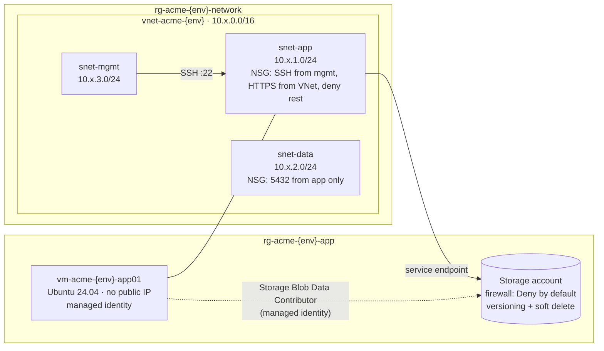
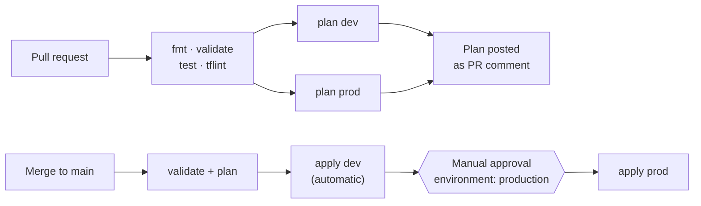

# Terraform Azure Landing Zone

[](https://github.com/codewithgarry/terraform-azure-landing-zone/actions/workflows/terraform.yml)


A small, production-style Azure landing zone built from **reusable Terraform modules**. It runs through a **GitHub Actions pipeline** that plans on every pull request, applies dev automatically and waits for **manual approval before prod**.

## ✨ Highlights

- **Reusable modules** for network (VNet, subnets, one NSG per subnet), Linux VM and storage account, each with secure defaults.
- **Remote state** in Azure Storage with Entra ID auth, no account keys, blob versioning and a delete lock.
- **Keyless CI/CD.** GitHub Actions logs in to Azure with **OIDC federated credentials**, so no client secret is stored anywhere.
- **Plan → review → apply.** Plans are posted on the PR. Prod apply is gated by a GitHub **environment approval**.
- **Tested.** `terraform test` with mocked providers checks naming, NSG coverage and storage hardening without touching Azure.

## 🏗️ Architecture



### CI/CD flow



## 📁 Repository structure

```text
.
├── bootstrap/                 # one-time: remote state storage, RBAC, delete lock
├── modules/
│   ├── network/               # VNet, subnets, NSG per subnet, rules as data
│   ├── linux-vm/              # private Ubuntu VM, SSH keys only, managed identity
│   └── storage-account/       # hardened StorageV2 + private containers (+ tests)
├── live/                      # root module composed from the modules
│   ├── env/
│   │   ├── dev.tfvars    dev.backend.hcl
│   │   └── prod.tfvars   prod.backend.hcl
│   └── tests/                 # terraform test with mocked providers
├── tests/mocks/               # shared mock data for the azurerm provider
└── .github/workflows/terraform.yml
```

One root module serves every environment. Differences live only in `env/<env>.tfvars` and `env/<env>.backend.hcl`, so dev and prod cannot drift in structure.

| Setting | dev | prod |
|---|---|---|
| Address space | `10.10.0.0/16` | `10.20.0.0/16` |
| VM size | `Standard_B2s` | `Standard_D2s_v5` |
| Storage replication | LRS | ZRS |
| Apply | automatic on merge | manual approval |

## 🚀 Getting started

### 1. Bootstrap remote state (once)

```bash
az login
cd bootstrap
terraform init
terraform apply -var="state_admin_object_id=<ci-service-principal-object-id>"
```

Copy the `storage_account_name` output into `live/env/dev.backend.hcl` and `live/env/prod.backend.hcl`.

### 2. Set up keyless GitHub Actions auth (OIDC)

```bash
APP_ID=$(az ad app create --display-name gh-terraform-landing-zone --query appId -o tsv)
az ad sp create --id $APP_ID
az role assignment create --assignee $APP_ID --role Contributor --scope /subscriptions/<SUBSCRIPTION_ID>
az role assignment create --assignee $APP_ID --role "User Access Administrator" --scope /subscriptions/<SUBSCRIPTION_ID>

# One federated credential per GitHub context that needs Azure access
for SUBJECT in \
  "repo:codewithgarry/terraform-azure-landing-zone:pull_request" \
  "repo:codewithgarry/terraform-azure-landing-zone:ref:refs/heads/main" \
  "repo:codewithgarry/terraform-azure-landing-zone:environment:dev" \
  "repo:codewithgarry/terraform-azure-landing-zone:environment:production"; do
  az ad app federated-credential create --id $APP_ID --parameters "{
    \"name\": \"$(echo $SUBJECT | tr ':/' '--')\",
    \"issuer\": \"https://token.actions.githubusercontent.com\",
    \"subject\": \"$SUBJECT\",
    \"audiences\": [\"api://AzureADTokenExchange\"]
  }"
done
```

> User Access Administrator is needed because the configuration creates role assignments. In a real organisation, scope it with a condition that limits which roles can be assigned.

Add these **repository secrets**: `AZURE_CLIENT_ID`, `AZURE_TENANT_ID`, `AZURE_SUBSCRIPTION_ID` and `VM_SSH_PUBLIC_KEY`.

Create two **environments** under Settings → Environments: `dev`, and `production` with **required reviewers**.

Finally, add the repository **variable** `AZURE_ENABLED=true` (Settings → Variables). Until then, only the validate and test job runs, so forks and fresh clones stay green.

### 3. Run locally

```bash
cd live
terraform init -backend-config=env/dev.backend.hcl
terraform plan -var-file=env/dev.tfvars
```

### 4. Run the tests

```bash
cd live
terraform init -backend=false
terraform test -var-file=env/dev.tfvars
```

## 🔐 Security decisions

| Decision | Why |
|---|---|
| OIDC instead of a client secret | Nothing long-lived to leak or rotate |
| No public IP on the VM | Smaller attack surface. Reach it via Bastion or the mgmt subnet |
| One NSG per subnet with explicit deny | Least privilege and an easy rule review per tier |
| Storage firewall `Deny` + service endpoint | Data reachable only from the app subnet |
| Managed identity + RBAC for blob access | No storage keys in app config |
| State: Entra ID auth, versioning, delete lock | Protects the most critical file in the project |

## 🧠 What I learned

- **Separate state per environment.** One state file per environment, with keys like `landing-zone/dev.tfstate`, keeps the blast radius small. A broken dev apply can never lock or corrupt prod state.
- **The plan you approve should be the plan you apply.** Saving the plan as an artifact and applying that exact file avoids surprises from changes that land between review and apply.
- **OIDC removes a whole class of incidents.** Federated credentials are scoped to a repo, branch or environment. A leaked workflow log has nothing reusable in it.
- **Model rules as data.** Passing NSG rules as a list of objects keeps modules generic. Reviews then focus on the rules themselves, not on HCL plumbing.
- **Mocked tests catch real mistakes cheaply.** `terraform test` with mock providers runs in seconds in CI. The provider's own ID validation still applies, which forced realistic mock data.
- **azurerm 4.x changes.** `storage_account_id` on containers goes through the management plane, so containers can be created even when the storage firewall denies the CI runner.

## 🛣️ Roadmap

- [ ] Hub-and-spoke topology with Azure Firewall
- [ ] Private endpoints instead of service endpoints
- [ ] Azure Policy assignments (allowed locations, required tags)
- [ ] Cost estimation on PRs with Infracost

## 👤 Author

**Girish Sharma** · Cloud & DevOps Engineer · HashiCorp Certified: Terraform Associate (003)
[GitHub](https://github.com/codewithgarry) · [LinkedIn](https://www.linkedin.com/in/codewithgarry/)
